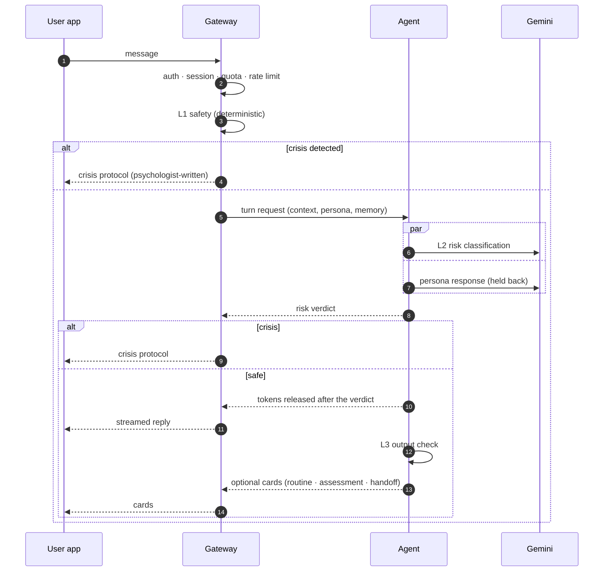
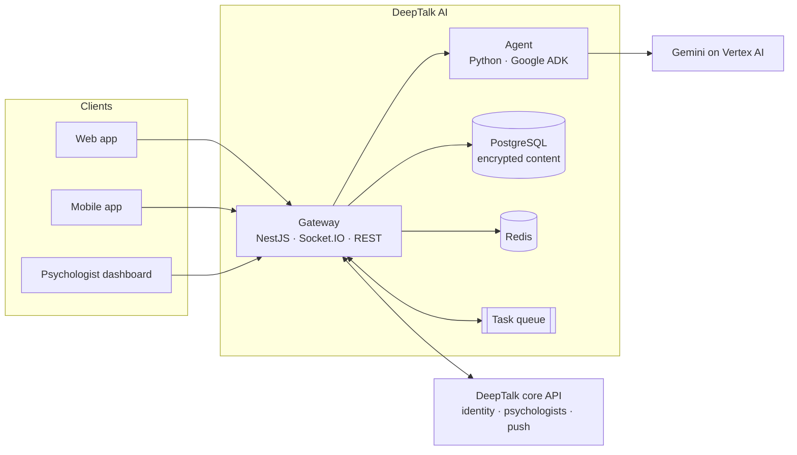

<div align="center">

# DeepTalk AI · *Teman AI*

**An AI companion to talk to, built on approaches designed by psychologists.**

Safety-first by architecture · Psychologist-in-the-loop · Privacy by design


</div>

---

## 🚀 Live demo

**URL:** [https://ai.deeptalk.co.id](https://ai.deeptalk.co.id)

There are two ways to sign in:

- **With Google:** sign in with your own Google account.
- **With the shared test account:**

  | Email | Password |
  |---|---|
  | `lentera-testing@maildrop.cc` | `@StrongK123` |

> [!TIP]
> The shared account is for evaluation only. Please don't enter real personal information when you try the demo.

## Why

Many people need someone to talk to *before* they are ready to book a psychologist, or between sessions. DeepTalk AI is that first, gentle step: a companion that listens, helps people reflect, offers small daily routines, and recognizes when it is time to bring in a human professional.

It is designed as a production service rather than a demo. Every decision starts from one question: **what keeps the user safe?**

> [!NOTE]
> DeepTalk AI is a supportive companion, **not** a diagnostic tool and **not** a replacement for professional care. In a crisis, the system always routes to a psychologist-written crisis protocol, never to free-form AI text.

## Highlights

| | |
|---|---|
| 🛡️ **Layered safety, fail-closed** | Three independent safety layers. Persona output is held back until the risk check passes. If the model or agent goes down, crisis detection keeps working. |
| 🧑‍⚕️ **Psychologists stay in control** | Personas, crisis protocols, routines, and assessment mappings are versioned content. Each version goes live only after a psychologist approves it. |
| 🎭 **Multiple personas, smart routing** | Several conversation styles (e.g. reflective, structured). A router picks the best fit for the user's need and topic. |
| 🌱 **Beyond chat** | Daily routines, self check-ins, screenings, personality inventories, and warm handoffs to a real psychologist. |
| 🧠 **Memory the user owns** | Short session summaries carry context forward. Users can view and delete their memory at any time. |
| 🔒 **Privacy by design** | Message content is encrypted at rest. Consent is versioned. Account deletion and merging propagate everywhere. Conversation content never appears in logs, traces, or metrics. |
| ⚡ **Real-time & scalable** | Streaming responses over Socket.IO. Stateless multi-instance services with durable state kept outside memory. |

## How a conversation turn works



### Safety layers

| Layer | Where | What it does | On failure |
|---|---|---|---|
| **L1** · deterministic | Gateway | Curated phrases and patterns for Indonesian, including slang and abbreviations | Runs locally with no network dependency |
| **L2** · classification | Agent | Structured risk verdict (`normal` / `elevated` / `crisis`) using psychologist-defined criteria | Timeout or error is treated as `elevated` |
| **L3** · output check | Agent | Blocks medication, dosage, and diagnostic language in replies | The reply is replaced with a safe template |

Session risk is *sticky*: once a session reaches crisis it stays there, and elevated sessions recover only after several calm turns in a row.

## Features

**For users** (web and mobile)
- 💬 Real-time chat with an AI companion, with persona choice or automatic routing
- 🗂️ Topics such as stress at work, anxiety, sleep, and quitting smoking
- ✅ Routine cards with reminders and progress tracking
- 📋 Self check: daily check-in, screening, and personality inventory
- 🤝 Handoff to a psychologist, with an optional pre-session summary that the user controls
- 🧾 Versioned consent, age gate, memory controls, history deletion, and "Report AI response"

**For psychologists** (dashboard and app)
- ✍️ Persona authoring from a questionnaire and case studies, evaluated before release
- 📚 Content curation: routines, knowledge, protocols, and topics, all versioned and approval-gated
- 🔔 Handoff inbox with AI-drafted summaries
- 🩺 Safety review queue and impact indicators

**For operators**
- 📈 SLO metrics and tracing that never carry conversation content
- 🚦 Release gates in the pipeline: crisis recall must be **100%**, and every active persona needs a passing evaluation
- 🧯 Runbooks for crisis incidents, model outages, unsafe responses, and data incidents
- 🎚️ Staged rollout (allowlist → percentage → general availability) with readiness checks

## Architecture



Three rules keep the system easy to reason about:

1. **Clients never call the agent.** The gateway is the only entry point.
2. **The agent has no data access.** It never touches the database or the core API. The gateway resolves all context and runs every data tool.
3. **Safety cannot be bypassed** by persona settings, quota limits, or model failures.

## Tech stack

| Area | Stack |
|---|---|
| Gateway | NestJS 11, Socket.IO, Prisma, PostgreSQL, Redis, zod, Pino, OpenTelemetry |
| Agent | Python 3.12, Google ADK, FastAPI (SSE), Pydantic, Gemini on Vertex AI |
| Infrastructure | Google Cloud (Cloud Run, Cloud Tasks, Cloud Scheduler, Secret Manager, KMS), Terraform, Cloud Build |
| Quality | Jest, pytest, mypy `--strict`, ESLint (type-checked), Ruff, end-to-end and load test suites |

## Repository layout

```
deeptalk-ai/
├── gateway/     # NestJS service: real-time chat, REST API, sessions, quota, consent, safety L1
├── agent/       # Python + ADK: router, personas, safety L2/L3, routines, handoff, summaries
├── content/     # Seed clinical content (DRAFT placeholders until approved by psychologists)
├── infra/       # Terraform modules and environments
├── cloudbuild/  # CI/CD pipelines with safety and persona release gates
├── e2e/         # Local end-to-end and load test scenarios
└── docs/        # Design, phases, runbooks, release playbooks (Indonesian)
```

## Getting started

**Prerequisites:** Node.js ≥ 24 with pnpm, Python 3.12 with [uv](https://docs.astral.sh/uv/), and Docker.

```bash
# Postgres + Redis
docker compose up -d

# Gateway → http://localhost:8080/v1/health
cd gateway
cp .env.example .env          # fill in local values; see comments in the file
pnpm install
pnpm exec prisma migrate dev  # local database only
pnpm run start:dev

# Agent → http://localhost:8000/health
cd agent
cp .env.example .env          # MODEL_PROVIDER=local runs a deterministic echo model, no cloud needed
uv sync
uv run uvicorn app.main:app --reload --port 8000
```

Local mode needs no cloud credentials. It uses a local encryption key and an offline echo model, and the environment validation rejects both in production.

### Checks

```bash
# gateway
pnpm run lint && pnpm run typecheck && pnpm run test && pnpm run test:e2e && pnpm run build

# agent
uv run ruff format . && uv run ruff check . && uv run mypy app agents tests && uv run pytest
```

## Project status

- ✅ Core platform, conversation, safety, consent and data lifecycle, psychologist portal, production hardening, and staged-rollout tooling are implemented and tested locally.
- 📝 **All clinical content in this repository is `DRAFT`.** It is a placeholder written by engineering and cannot be activated until a psychologist reviews and approves it.
- 🔐 No real user or counseling data is used for evaluation or training. That stays locked behind an explicit data-governance gate.

## Documentation

Full design and engineering documentation, written in Indonesian, lives in [`docs/`](docs/README.md). Good starting points:

- [Implementation design](docs/02-implementasi.md)
- [Phases & roadmap](docs/03-phase.md)
- [SLOs](docs/slo.md) · [Runbooks](docs/runbooks/README.md) · [Staged rollout](docs/rilis/peluncuran-bertahap.md)

---

<div align="center">
<sub>Built with care for people who need someone to talk to.</sub>
</div>
