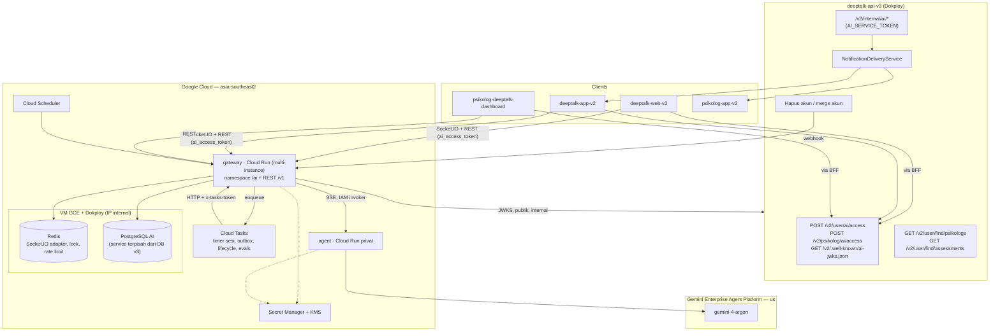
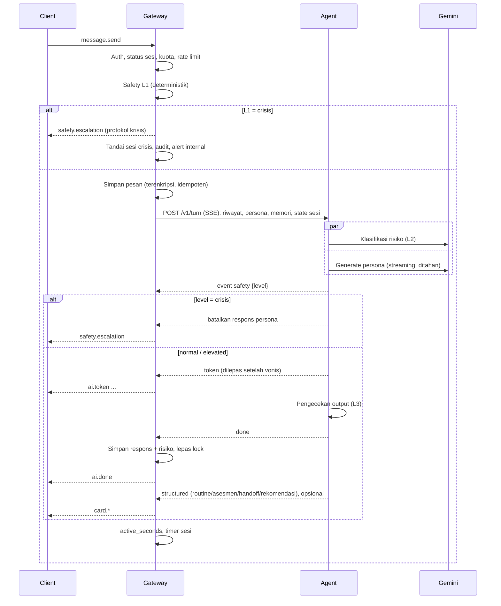

# DeepTalk AI — Dokumen Implementasi

**Versi:** 8 Oktober 2026 (rev. 2: produk produksi) · **Status:** Draft untuk didiskusikan
**Pembaca:** engineer yang membangun dan mengoperasikan DeepTalk AI
**Dasar:** dokumen konsep §1–§8 di [`docs/deeptalk-ai/`](../../docs/deeptalk-ai/), dengan revisi dari [01-review-dokumen-dan-codebase.md](01-review-dokumen-dan-codebase.md)

Dokumen ini menjelaskan **bagaimana** DeepTalk AI dibangun dan dioperasikan di produksi. Untuk **apa** dan **mengapa** dari sisi produk, rujukannya tetap dokumen konsep. Urutan pengerjaan ada di [03-phase.md](03-phase.md).

---

## 1. Ringkasan dan Tujuan

DeepTalk AI adalah layanan terpisah dengan dua komponen. Untuk versi beta, data disimpan di Singapura; untuk production atau rilis resmi, data disimpan di Indonesia (`asia-southeast2`). Model AI dipanggil melalui Google Cloud Gemini Enterprise Agent Platform (Vertex AI) di Amerika Serikat (region **`us`**):

- **`gateway`** (NestJS, Cloud Run). Pintu masuk client: Socket.IO, sesi, kuota, consent, penyimpanan percakapan, routine, handoff, konten klinis, dan API psikolog.
- **`agent`** (Python + ADK, Cloud Run privat). Logika AI: router, persona, safety, routine, handoff, dan ringkasan.

Keduanya bergantung pada `deeptalk-api-v3` untuk identitas (token exchange), data publik (psikolog, asesmen), data pengguna dan booking (endpoint internal), serta push. Client: `deeptalk-web-v2`, `deeptalk-app-v2`, dan `psikolog-deeptalk-dashboard`.

| Tujuan produksi | Implikasi desain |
|---|---|
| Aman lebih dulu | Safety berlapis yang tidak bisa dilewati persona, kuota, atau kegagalan model; runbook insiden krisis |
| Psikolog memegang kendali | Semua konten klinis (persona, routine, protokol, pemetaan asesmen) berversi dan hanya aktif setelah disetujui psikolog |
| Privasi sesuai UU PDP | Data beta disimpan di Singapura; data production/rilis resmi disimpan di Indonesia. Pemrosesan AI di AS melalui Google Cloud Gemini Enterprise Agent Platform (Vertex AI); lokasi dan transfer dijelaskan di consent dan kebijakan privasi. Enkripsi isi, consent berversi, hapus/merge akun, retensi |
| Tidak mengganggu `deeptalk-api-v3` | Perubahan di v3 hanya berupa endpoint tambahan, tanpa migrasi skema |
| Andal dan bisa diskalakan | Multi-instance sejak awal, state di luar memori, observability dan SLO |
| Biaya terkendali | Batas token per sesi, model sesuai tugas, alert anggaran |

---

## 2. Peta Sistem yang Ada

| Repo | Stack | Peran untuk DeepTalk AI |
|---|---|---|
| `deeptalk-api-v3` | NestJS 11, Prisma 7, PostgreSQL, Redis, BullMQ, Socket.IO; route `/v2`; Dokploy | Penerbit token AI + JWKS, data psikolog/asesmen/booking, pengirim push |
| `deeptalk-web-v2` | Next.js 16, React 19, TanStack Query, `socket.io-client`; BFF cookie httpOnly | Client pengguna (web) |
| `deeptalk-app-v2` | Expo 57, expo-router, `socket.io-client`, FCM | Client pengguna (mobile) |
| `psikolog-deeptalk-dashboard` | Next.js 16, TanStack Query, Zustand | Handoff, evaluasi, kurasi persona dan konten |
| `psikolog-app-v2` | Expo 57 | Notifikasi handoff dan akses cepat ke ringkasan |
| `deeptalk-ai` (repo ini) | Baru | `gateway/`, `agent/`, `infra/`, `docs/` |

---

## 3. Arsitektur Target



**Aturan arah panggilan:**

- Client tidak pernah memanggil `agent`.
- `agent` tidak pernah memanggil v3 atau database. Semua tool yang butuh data dijalankan gateway; agent hanya menerima konteks dan hasil tool.
- v3 memanggil gateway hanya untuk webhook siklus hidup akun.

---

## 4. Keputusan Arsitektur

Keputusan di dokumen teknis yang sebelumnya dibenarkan oleh penilaian kompetisi sudah dinilai ulang dengan alasan produksi.

| # | Keputusan | Alasan produksi | Alternatif yang ditolak |
|---|---|---|---|
| A1 | Layanan AI terpisah dari v3 | Isolasi data percakapan yang sensitif, runtime Python untuk AI, siklus rilis terpisah dari v3, dan v3 tidak ikut menanggung beban atau insiden AI | Modul `ai` di dalam v3: tidak perlu bridge auth, tetapi data percakapan masuk ke DB utama dan v3 menjalankan beban LLM |
| A2 | Google Cloud + Gemini Enterprise Agent Platform (Vertex AI) di `us` | Data beta disimpan di Singapura; data production/rilis resmi disimpan di Indonesia. AI diproses di AS melalui Gemini Enterprise Agent Platform. Gemini 4 Argon tidak tersedia di Jakarta; `us` dipilih karena menjamin pemrosesan di satu yurisdiksi (`global` tidak menjamin lokasi) | Host di infrastruktur v3 dan memanggil Gemini API dari sana |
| A3 | Integrasi hanya ke `deeptalk-api-v3` | v3 menjadi satu-satunya API (K-D9) | Laravel legacy |
| A4 | Token exchange dengan ES256 + JWKS | Lihat review T2–T4. Gateway tidak memegang rahasia yang bisa membuat token. Rotasi kunci lewat JWKS tanpa redeploy gateway | HS256 shared secret; verifikasi JWT v3 langsung |
| A5 | Gateway NestJS | Tim menguasai NestJS; pola bisa disalin dari `src/modules/chat` v3 | Gateway Python |
| A6 | Agent Python + ADK | ADK paling matang di Python, dengan orkestrasi multi-agen dan tooling evaluasi bawaan | Gen AI SDK langsung (orkestrasi dan evaluasi dibangun sendiri) |
| A7 | Safety gate sebelum token dialirkan | Respons yang tidak aman tidak boleh sempat tampil | Streaming langsung lalu ditarik kembali |
| A8 | Multi-instance + Redis + Cloud Tasks sejak awal | Tidak ada state di memori instance; deploy tanpa memutus sesi; timer tahan restart. Antrian di Cloud Tasks (bukan BullMQ, keputusan topologi 2026-10-15): terkelola, tidak memakai Redis di VM untuk data yang harus tahan lama, dan memanggil gateway lewat HTTP sehingga cocok dengan Cloud Run yang bisa menskalakan ke instance mana pun | Satu instance dengan timer di memori; BullMQ di Redis VM |
| A9 | Portal psikolog di `psikolog-deeptalk-dashboard` | Login psikolog dan BFF sudah ada | App baru |
| A10 | Data routine di Postgres AI | Routine lahir dari percakapan; satu batas data untuk consent, retensi, dan penghapusan | Tabel routine di DB v3 |
| A11 | Push lewat v3 | Token device ada di v3 (`devices`) | FCM langsung dari GCP |
| A12 | Database sebagai sumber kebenaran konten klinis, dengan versi dan persetujuan | Psikolog mengelola sendiri lewat dashboard; jejak audit siapa menyetujui apa | Konten sebagai file di repo |

---

## 5. Kontrak Integrasi dengan deeptalk-api-v3

Setiap perubahan di v3 mengikuti konvensi repo tersebut: envelope `{ success, message?, data }`, unit test `.spec.ts`, `openapi.yaml`, dan recap `docs/tasks/YYYYMMDD-<task>.md` (lihat `AGENT.md` v3). Tidak ada perubahan skema DB v3.

### 5.1 Endpoint baru

| Endpoint | Guard | Fungsi | Phase |
|---|---|---|---|
| `GET /v2/user/ai/availability` | `UserAuthGuard` | `{ available, reason? }` agar client tahu apakah menampilkan pintu masuk Teman AI | 1 |
| `POST /v2/user/ai/access` | `UserAuthGuard` | Menerbitkan `ai_access_token` pengguna | 1 |
| `POST /v2/psikolog/ai/access` | `PsikologAuthGuard` + `PsikologVerifiedGuard` | Menerbitkan `ai_access_token` psikolog | 1 |
| `GET /v2/.well-known/ai-jwks.json` | Publik | Kunci publik untuk verifikasi token AI | 1 |
| `GET /v2/internal/ai/users/:userId` | `AiServiceTokenGuard` | Profil minimal: `nickname`, `birth_date`, `gender` | 1 |
| `GET /v2/internal/ai/users/:userId/assessments` | `AiServiceTokenGuard` | Ringkasan asesmen selesai (nama tes, tanggal, kategori hasil) | 3 |
| `GET /v2/internal/ai/bookings/:bookingId` | `AiServiceTokenGuard` | `{ user_id, psikolog_id, status, counseling_datetime }` untuk verifikasi tautan handoff | 3 |
| `POST /v2/internal/ai/notifications` | `AiServiceTokenGuard` | Push ke pengguna atau psikolog lewat `NotificationDeliveryService` (batch, idempoten per `notification_key`) | 3 |
| `GET /v2/psikolog/book/:bookingId/ai-summary` | `PsikologAuthGuard` | Ringkasan handoff yang tertaut ke booking milik psikolog (diteruskan ke gateway) | 3 |
| `GET /v2/internal/ai/account-events?after_id=&limit=` | `AiServiceTokenGuard` | Feed hapus/merge akun dari `deleted_data` (ditulis dalam transaksi yang sama dengan penghapusan) — outbox tanpa perubahan skema; ditarik gateway berkala | 4 |
| Webhook keluar ke gateway saat hapus/merge akun | — | Jalur cepat setelah commit (tutup akun, hapus oleh admin, merge); best effort, karena feed di atas adalah jaminannya. Lihat §9.3 | 4 |

`AiServiceTokenGuard` mengikuti pola guard `LOGOS_CALLBACK_TOKEN`: membandingkan header `x-ai-service-token` dengan konstanta waktu tetap dan mengembalikan `503` bila env tidak diset (gagal tertutup). Arah sebaliknya (v3 → gateway) memakai token servis terpisah.

### 5.2 Token AI

Respons `POST /v2/user/ai/access` sengaja mirip dengan `chat-access` agar logika client bisa dipakai ulang:

```json
{
  "success": true,
  "data": {
    "ai_access_token": "<jwt>",
    "expires_in": 900,
    "transport": {
      "http_base_url": "https://ai.deeptalk.id/v1",
      "socket_base_url": "https://ai.deeptalk.id",
      "namespace": "/ai"
    }
  }
}
```

Klaim JWT (header `alg: ES256`, `kid`):

```json
{
  "iss": "deeptalk-api",
  "aud": "deeptalk-ai",
  "sub": "<users.id atau id psikolog>",
  "role": "user | psikolog",
  "jti": "<uuid>",
  "iat": 0,
  "exp": 0
}
```

- Kunci privat hanya ada di v3 (`AI_JWT_PRIVATE_KEY`, `AI_JWT_KID`). Gateway mengambil JWKS dan meng-cache-nya. Rotasi: terbitkan `kid` baru, biarkan `kid` lama di JWKS sampai semua token lama kedaluwarsa.
- TTL 15 menit. Client meminta token baru 30 detik sebelum kedaluwarsa. Logout di v3 menghentikan penerbitan token, jadi sesi AI berhenti paling lambat 15 menit setelahnya. Socket yang sedang terhubung diputus gateway saat `exp` tercapai, kecuali client sudah mengirim token baru lewat event `auth.refresh`.
- **Peluncuran bertahap** diatur di v3: `AI_ROLLOUT_MODE` = `off | allowlist | percentage | all`, dengan `AI_ALLOWED_USER_IDS` dan `AI_ROLLOUT_PERCENT` (hash stabil dari `user_id`). Pengguna di luar rollout menerima `403 AI_NOT_AVAILABLE`.

### 5.3 Data publik yang dipakai gateway

| Kebutuhan | Endpoint v3 yang sudah ada | Catatan |
|---|---|---|
| Psikolog + spesialisasi | `GET /v2/user/find/psikologs`, `GET /v2/user/find/psikolog/:id` | `DirectoryEntry`: `id`, `name`, `avatar`, `specialists[]`, `experience_since`. Cache 5 menit di Redis gateway |
| Layanan dan harga psikolog | `GET /v2/user/find/psikolog/:id/services` | Teks kartu handoff |
| Katalog asesmen | `GET /v2/user/find/assessments`, `GET /v2/user/assessment/free-test` | Disaring dengan `ai_assessment_mappings` |

### 5.4 Deep link dari kartu

| Kartu | Web (`deeptalk-web-v2`) | App (`deeptalk-app-v2`) |
|---|---|---|
| Asesmen | `/assessment/[id]` | `assessment/[id]` |
| Psikolog | `/psychologists/[id]?ai_handoff=<id>` | `counseling/psychologist/[id]?ai_handoff=<id>` |
| Bantuan darurat | `/deeptalk-ai/bantuan` (publik; `/teman-ai/*` dialihkan permanen ke `/deeptalk-ai/*`) | Layar bantuan bawaan app (bisa dibuka offline) |

### 5.5 Alur tautan handoff ke booking

1. Pengguna menyetujui ringkasan → `ai_handoffs.status = approved`.
2. Kartu membuka halaman psikolog dengan parameter `ai_handoff`. Client menyimpan ID ini selama alur booking.
3. Setelah booking dibuat, client memanggil gateway `POST /v1/handoffs/:id/link { booking_id }`.
4. Gateway memverifikasi lewat `GET /v2/internal/ai/bookings/:bookingId` bahwa `user_id` cocok dengan pemilik handoff dan `psikolog_id` cocok (atau mencatat bahwa pengguna memilih psikolog lain). Setelah itu `booking_id` diisi.
5. Gateway mengirim notifikasi ke psikolog lewat `POST /v2/internal/ai/notifications`.
6. Psikolog membaca ringkasan di dashboard atau lewat `GET /v2/psikolog/book/:bookingId/ai-summary`. Gateway memverifikasi bahwa psikolog itulah yang ditugaskan di booking tersebut.

Jika pengguna memesan psikolog lain, ringkasan hanya dibagikan ke psikolog tersebut setelah pengguna mengonfirmasi ulang.

---

## 6. Gateway

### 6.1 Struktur modul

```
gateway/src/
├── config/            # env schema (zod), seperti v3
├── auth/              # JWKS client, AiAuthGuard (REST), verifikasi handshake socket, token servis
├── realtime/          # AiGateway (namespace /ai), Redis adapter
├── sessions/          # siklus sesi, kuota, waktu aktif, timer (Cloud Tasks)
├── messages/          # pesan terenkripsi, riwayat, idempotensi
├── agent-client/      # klien SSE ke agent (+ ID token)
├── safety/            # L1 deterministik, kebijakan eskalasi, audit, alert
├── routines/          # pustaka, usulan, routine pengguna, log, pengingat
├── handoffs/          # draft, persetujuan, tautan booking, akses psikolog
├── assessments/       # pemetaan topik ke asesmen, tool katalog
├── consents/          # consent layanan dan pelatihan
├── content/           # Persona Card, protokol, pustaka routine: versi dan persetujuan
├── evals/             # studi kasus, run, penilaian psikolog
├── lifecycle/         # webhook hapus/merge akun, hapus riwayat, retensi
├── v3-client/         # klien HTTP ke deeptalk-api-v3
├── observability/     # metrik, tracing, log aman
└── health/
```

### 6.2 Event Socket.IO (namespace `/ai`)

| Event | Arah | Payload utama | Catatan |
|---|---|---|---|
| `session.start` | C→S | `{ persona_id?, locale?, nickname? }` (`persona_id` kosong = Quick Chat) | Sesi baru tercatat saat pesan pertama. `nickname` (1–50 karakter: huruf, angka, spasi, `.'-`; spasi dirapikan) hanya berlaku untuk sesi itu: disimpan di Redis `session-nickname:<sesi>` dan menggantikan nama panggilan profil v3 di `memory.profile` agent; profil v3 tidak diubah. Web (2026-10-18) selalu memakai Quick Chat: alur awal = data diri (gender + tanggal lahir, sekali, ke profil v3) → nama panggilan + cerita (pesan pertama) |
| `session.start` | C→S | `{ persona_id? }` | (lihat baris pertama) Ack `{ ok }`. Sebelum pesan pertama pilihan disimpan di Redis; saat sesi berjalan = `persona.switch` |
| `session.state` | S→C | `{ session_id, status: none\|active\|closing\|ended, active_seconds, active_limit_seconds, risk_level, persona: { id, display_name, label, approach, focus_topics, draft } \| null, quick_chat, router_reason, quota: { used, limit, resets_at } }` | Juga dikirim saat (re)connect dan setiap persona/risiko berubah |
| `auth.refresh` | C→S | `{ token }` | Memperpanjang socket tanpa reconnect |
| `message.send` | C→S | `{ client_message_id, content }` | Ack: `{ ok, client_message_id, message_id, duplicate, session_id }` (+ event `message.ack { client_message_id, message_id }` ke room). `session_id` membuat ruang baru langsung pindah ke URL `/deeptalk-ai/<id>` |
| `ai.token` | S→C | `{ message_id, delta }` | Hanya setelah safety gate lolos |
| `ai.done` | S→C | `{ message_id, content, replaced, created_at }` | `content` otoritatif: bila L3 mengganti balasan (`replaced: true`), client mengganti teks yang sudah ter-stream |
| `ai.error` | S→C | `{ code, message, message_id?, help? }` | Pesan pengguna tetap tersimpan; client menawarkan kirim ulang. Saat agent tidak tersedia, `help: { url, contacts }` (gagal tertutup) |
| `session.warning` | S→C | `{ remaining_seconds }` | Saat waktu aktif mencapai 25 menit |
| `session.closing` | S→C | `{ closes_at }` | Batas waktu aktif tercapai; sesi ditutup setelah tenggang |
| `session.ended` | S→C | `{ session_id, reason: completed \| idle \| wall_clock \| user_ended, quota, consent_offer }` | `consent_offer` = tawaran consent pelatihan (§9.2) atau `null` |
| `quota.exhausted` | S→C | `{ quota, resets_at, message, alternatives: [routine, assessment, psikolog], help: { contacts }, risk_level }` | Hanya setelah L1 + L2 (§6.3). Info bantuan selalu ikut. Ack `message.send` = `QUOTA_EXHAUSTED` |
| `safety.escalation` | S→C | `{ level: elevated \| crisis, protocol: { level, title, message, contacts[], offer_psikolog, version }, message_id?, help_url? }` | `protocol` = konten berversi dari psikolog. `crisis` disimpan sebagai pesan `role: protocol` |
| `card.routine` | S→C | `{ proposal_id, routine: { topic, title, personalization_note, items[] }, status: proposed, message_id }` | Item = snapshot pustaka (ID, versi, judul, jenis, waktu). `message_id` = balasan asal; client menampilkan kartu tepat di bawahnya |
| `routine.decision` | C→S | `{ proposal_id, decision: accept \| edit \| reject, routine?: { item_ids?, reminder_times?, timezone? } }` | `edit` hanya boleh mengurangi item. Ack `{ ok, routine_id }` |
| `card.assessment` | S→C | `{ assessment_id, title, reason, is_free, topic, referral_id, message_id }` | Judul dari katalog v3, bukan dari agent. `referral_id` dicatat sebagai rujukan (Phase 7) |
| `card.handoff` | S→C | `{ handoff_id, psikolog: { id, name, avatar, specialists }, reason, draft_sections[], disclaimer }` | |
| `card.recommendation` | S→C | `{ recommendation_id, message_id, reason, psikologs: [{ id, name, avatar, specialists[], year_experience, rating: { rate, total } \| null, price_from, reason, persona_label }] }` | 1–3 psikolog dari direktori v3, sekali per sesi, tidak saat `crisis`. Hanya menautkan ke profil publik; tidak ada data pengguna yang dibagikan (berbeda dari handoff). Web 16 Okt; app menyusul |
| `handoff.decision` | C→S | `{ handoff_id, decision: approve \| decline, removed_section_ids[] }` | Ack `{ ok, status, deep_links: { web, app } }` |
| `consent.request` | S→C | `{ type: ai_training, text_version }` | Tidak pernah saat `elevated`/`crisis` |
| `consent.decision` | C→S | `{ type, granted }` | |
| `persona.switch` | C→S | `{ persona_id }` | Berlaku mulai giliran berikutnya |
| `persona.unavailable` | S→C | `{ persona_id, fallback_persona }` | Persona dinonaktifkan psikolog di tengah sesi |

Konfigurasi: `transports: ['websocket']`, CORS sesuai `CORS_ORIGINS` (app mobile tidak mengirim Origin), dan Redis adapter untuk fan-out lintas instance. Satu pengguna hanya punya satu sesi aktif. Tab atau perangkat kedua bergabung ke sesi yang sama dan menerima event yang sama.

**Satu giliran per sesi** (lock Redis). Lock dilepas setelah balasan tersimpan dan *sebelum* `ai.done`/protokol dipancarkan, sehingga pesan berikutnya tidak pernah membentur lock karena pemrosesan kartu. Pesan yang L1-nya `crisis` tidak pernah ditolak `TURN_IN_PROGRESS`: jalur krisis tidak memanggil agent, jadi berjalan tanpa lock.

**Reload di tengah giliran.** Giliran berjalan di gateway terlepas dari socket; event dikirim ke room `user:<id>`, jadi socket baru (instance mana pun) menerima sisa `ai.token` dan `ai.done`. Selama balasan ditulis, `GET /sessions/current` mengembalikan `pending_reply`: client menampilkan indikator mengetik, tidak mengizinkan kirim, mengabaikan delta yang awalnya sudah hilang, dan menunggu `ai.done` (teks lengkap); bila `ai.done` lewat sebelum socket bergabung, client membaca ulang riwayat sekali saat `session.state` pertama, dan lagi bila 20 dtk tanpa tanda. Pesan user terakhir tanpa balasan dan tanpa `pending_reply` berarti giliran gagal saat halaman pergi: client menawarkan "coba lagi" dengan `client_message_id` yang sama (jalur idempoten). Karena giliran berjalan di background, gateway di Cloud Run harus memakai CPU selalu aktif (`--no-cpu-throttling`).

### 6.2a REST gateway (`/v1`)

| Endpoint | Auth | Fungsi |
|---|---|---|
| `GET /personas` | token AI user | Daftar persona aktif untuk pemilih |
| `GET /help` | publik | Protokol `crisis` dan `elevated` aktif (halaman bantuan web, cache offline app) |
| `GET /sessions/current` | user | Sesi, 50 pesan terakhir (pesan user membawa `client_message_id` agar bisa dikirim ulang secara idempoten), `pending_reply` (`{ user_message_id, message_id, started_at }` selama balasan masih ditulis — dari Redis `turn:inflight:<sesi>`, hanya ID; `null` bila tidak ada), `state`, `cards` (semua kartu rutinitas + rekomendasi sesi, diputuskan atau belum, dengan `message_id` dan `status`), `pending_cards` (lama, untuk app) |
| `GET /sessions?before=` | user | Riwayat sesi milik sendiri yang masih punya pesan, terbaru dulu, 20 per halaman: `{ items: [{ id, status, started_at, ended_at, end_reason, persona_label, preview }], next_before }`. `preview` = pesan pertama pengguna (≤ 90 karakter) sebagai judul sesi. Sesi yang dikosongkan "hapus riwayat" atau retensi tidak ditampilkan |
| `GET /sessions/:id` | user | Satu sesi milik sendiri + transkrip (maks. 200 pesan) + `router_reason` + `cards` (seperti di atas); selain itu 404. Web: `/teman-ai/:id` (live bila sesi terbuka, baca-saja bila berakhir) |
| `POST /sessions/:id/end` | user | "Akhiri sesi": menutup sesi dengan alasan `user_ended` (ringkasan sesi tetap diantrekan); idempoten; socket menerima `session.ended` seperti penutupan lain |
| `GET`/`PATCH /me/settings`, `DELETE /me/memory` | user | Pengaturan dan penghapusan memori lintas sesi |
| `GET /routines`, `POST /routines/:id/logs`, `GET /routines/:id/history`, `GET /routines/:id/summary`, `PATCH /routines/:id` | user | Layar Rutinitas; tidak memakai kuota |
| `GET /handoffs/:id`, `POST /handoffs/:id/link`, `POST /handoffs/:id/confirm` | user | Status handoff, tautan ke booking, konfirmasi ulang psikolog lain |
| `GET /me/onboarding` | user | Gerbang usia + consent: `{ ready, blocked: { code, message } \| null, age, consents }` |
| `GET /me/consents`, `POST /me/consents { type, text_version, granted }` | user | Consent berversi; mencabut `service` menutup sesi berjalan; mencabut `ai_training` mengeluarkan semua sesi dari pelatihan |
| `DELETE /me/history` | user | Hapus pesan, ringkasan, usulan routine, handoff yang belum dibagikan; baris sesi (kuota) dan routine tetap |
| `GET /psikolog/me`, `GET /psikolog/persona`, `PUT /psikolog/persona/questionnaire`, `PUT /psikolog/persona/cases/:ref`, `POST /psikolog/persona/draft`, `POST /psikolog/persona/versions`, `POST /psikolog/persona/versions/:v/eval-runs`, `GET /psikolog/persona/eval-runs/:id`, `PUT …/ratings/:ratingId`, `POST /psikolog/persona/versions/:v/approve`, `POST /psikolog/persona/{disable,enable}` | psikolog | Kurasi persona (Phase 5) |
| `GET /psikolog/persona/status` | psikolog | Tahap penyusunan persona untuk card Beranda dashboard (`not_started`, `questionnaire`, `cases`, `draft`, `review`, `active`, `disabled`, `unavailable`). Hanya membaca: tidak membuat workspace |
| `GET /psikolog/handoffs`, `GET /psikolog/handoffs/:id` | psikolog | Ringkasan yang tertaut ke booking psikolog itu; membuka = `viewed` |
| `GET /review/content`, `GET /review/content/:kind/:ref`, `POST …/versions`, `POST …/versions/:v/{submit,approve,reject}` | psikolog + `clinical_reviewer` | Kurasi konten klinis; penyetuju ≠ penulis; seed engineering tidak bisa disetujui |
| `GET /review/safety-events?status=&level=&before=`, `PATCH /review/safety-events/:id` | psikolog + `clinical_reviewer` | Tinjauan keamanan tanpa isi dan tanpa identitas pengguna |
| `POST /assessments/referrals/:id/opened` | user | Kartu asesmen dibuka (indikator dampak); idempoten, hanya milik sendiri |
| `POST /recommendations/:id/opened` `{ psikolog_id }` | user | Profil psikolog dari kartu rekomendasi dibuka (indikator dampak); idempoten, hanya milik sendiri dan hanya psikolog yang ada di kartu |
| `GET /review/impact?days=` | psikolog + `clinical_reviewer` | Indikator dampak Konsep §8, agregat tanpa ID pengguna (Phase 8: `self_checks` — hitungan check-in/skrining/inventori dan butir keamanan, tanpa skor) |
| `GET /topics` | user | Label topik (kind `topic`) untuk filter pemilih persona (Phase 8) |
| `GET /instruments?tz=`, `GET /instruments/:ref?tz=` | user | Cek diri (Phase 8): daftar instrumen + status (`due`, `answered_today`, `next_due`); detail tanpa ambang keamanan, kunci terbalik, atau rentang |
| `POST /instruments/:ref/responses { answers, timezone }` | user | Gerbang usia + consent layanan; validasi versi; skor dan rentang dihitung gateway; satu entri per hari lokal (hari yang sama = koreksi); di luar interval → 409 `INSTRUMENT_NOT_DUE`; butir keamanan → `protocol` + kejadian keamanan `layer = instrument` |
| `GET /instruments/:ref/responses?days=&tz=` | user | Riwayat/tren milik sendiri (terdekripsi); baris yang gagal didekripsi dilewati |
| `DELETE /instruments/responses/:id`, `DELETE /instruments/responses` | user | Hapus satu entri / semua data cek diri (terpisah dari `DELETE /me/history`) |
| `GET /psikolog/data-consent`, `POST /psikolog/data-consent { text_version, allow_evaluation, allow_style_examples, allow_training }` | psikolog | Addendum pemanfaatan respons (Phase 9) |
| `GET /review/dataset/summary`, `GET /review/dataset?status=&before=`, `GET /review/dataset/:id`, `PATCH /review/dataset/:id { decision, review_notes }` | psikolog + `data_reviewer` | Tinjauan item dataset yang sudah disamarkan; tanpa identitas pengguna (Phase 9) |
| `GET /review/coverage` | psikolog + `clinical_reviewer` | Cakupan per topik (persona/pengetahuan/routine/pemetaan: disetujui vs draf, yang kurang) dan progres persona psikolog |
| `POST /messages/:id/report { reason, share_content }` | user | Laporkan balasan AI (kebijakan Play: konten buatan AI). Tanpa ID pengguna dan tanpa teks bebas |
| `GET /review/reports?status=`, `PATCH /review/reports/:id` | psikolog + `clinical_reviewer` | Tinjauan laporan; teks balasan hanya bila pengguna mengizinkan dan pesannya masih ada |
| `POST /internal/users/:id/delete`, `POST /internal/users/merge` | `x-ai-gateway-token` (dari v3) | Webhook siklus hidup akun, idempoten per `event_id` |
| `GET /internal/handoffs/by-booking/:bookingId?psikolog_id=` | `x-ai-gateway-token` (dari v3) | Ringkasan untuk psikolog yang ditugaskan; selain itu 404 |
| `POST /internal/scheduler/routine-reminders` | `x-scheduler-token` | Dipanggil Cloud Scheduler tiap 5 menit |

### 6.3 Sesi, waktu aktif, dan kuota

**Definisi waktu aktif.** Setiap aktivitas (pesan pengguna dan selesainya respons AI) menambah `active_seconds` sebesar `min(jeda sejak aktivitas sebelumnya, ACTIVE_GAP_CAP)`.

| Parameter | Nilai awal | Keterangan |
|---|---|---|
| `SESSION_QUOTA_PER_MONTH` | 10 | Bulan kalender `Asia/Jakarta` |
| `SESSION_ACTIVE_LIMIT_SECONDS` | 1800 | 30 menit waktu aktif |
| `SESSION_WARNING_AT_SECONDS` | 1500 | Menit ke-25 |
| `SESSION_GRACE_SECONDS` | 180 | Tenggang penutupan (Q11) |
| `ACTIVE_GAP_CAP_SECONDS` | 120 | Jeda maksimum yang dihitung |
| `SESSION_IDLE_TIMEOUT_SECONDS` | 1800 | Q11 |
| `SESSION_MAX_WALL_CLOCK_SECONDS` | 10800 | Sesi tidak membentang seharian |

Semua parameter dibaca dari konfigurasi, sehingga bisa disetel tanpa rilis kode.

**Aturan:**

1. Sesi dibuat saat pesan pertama, di dalam transaksi yang mengunci baris `ai_user_state` (`SELECT … FOR UPDATE`), agar dua perangkat tidak bisa melewati kuota bersamaan.
2. Sesi yang pernah `crisis` tidak dihitung dalam kuota (`counts_toward_quota = false`).
3. Saat kuota habis, pesan tetap melewati safety L1 dan L2. Jika `crisis`, sesi krisis dibuka. Jika tidak, kirim `quota.exhausted` dengan pesan hangat.
4. Pada 1500 detik: `session.warning` ke client dan `wrap_up=true` ke agent.
5. Pada 1800 + 180 detik: sesi ditutup setelah respons yang sedang berjalan selesai.
6. Sesi `crisis` melewati semua batas waktu.
7. Timer idle dan wall-clock dijadwalkan sebagai task Cloud Tasks tertunda per sesi (`ai-session-timers`) dan dijadwalkan ulang di setiap aktivitas. Nama task memuat waktu jatuh tempo, karena Cloud Tasks menolak nama yang sama selama ±1 jam. Cloud Tasks memanggil `POST /v1/internal/tasks/:queue` (header `x-tasks-token`) di instance gateway mana pun; handler bersifat idempoten (*at-least-once*), jadi aman terhadap restart dan multi-instance. Lokal dan E2E memakai driver Postgres `ai_local_tasks` dengan perilaku yang sama (`TASKS_DRIVER=local`, ditolak di production).

### 6.4 Alur satu giliran percakapan



### 6.5 Memori lintas sesi

Saat sesi berakhir, task outbox meminta agent membuat ringkasan (`POST /v1/session/summary`) yang disimpan di `ai_session_summaries`. Konteks sesi berikutnya berisi:

- 3 ringkasan sesi terakhir.
- Routine aktif dan kepatuhan 7 hari terakhir.
- Rekomendasi asesmen atau handoff yang belum ditindaklanjuti.
- Profil minimal: nama panggilan dan kelompok usia, bukan tanggal lahir.

Pengguna bisa melihat dan menghapus memori ini di pengaturan Teman AI. Ringkasan sesi `crisis` disimpan untuk keselamatan dan diberi flag `exclude_from_training`.

---

## 7. Layanan Agent

### 7.1 Endpoint internal

Hanya bisa dipanggil service account gateway (Cloud Run IAM invoker, ingress internal).

| Endpoint | Fungsi | Model |
|---|---|---|
| `POST /v1/turn` (SSE) | Satu giliran: safety, persona, output terstruktur | Tier chat |
| `POST /v1/router/select` | Quick Chat: `persona_id`, `reason`, `initial_risk`, `topics` | Tier chat |
| `POST /v1/safety/classify` | L2 saja, untuk pesan tanpa balasan persona (kuota habis) | Tier chat |
| `POST /v1/session/summary` | Ringkasan sesi | Tier chat |
| `POST /v1/handoff/draft` | Draft ringkasan pra-sesi | Tier dokumen |
| `POST /v1/persona/draft` | Draft Persona Card dari kuesioner dan jawaban studi kasus (tanpa `few_shots`: gateway menambahkan jawaban psikolog apa adanya) | Tier dokumen |
| `POST /v1/eval/run` | Studi kasus terhadap versi persona tertentu, lewat L2 dan L3 seperti giliran sungguhan; `crisis` = respons persona dibatalkan | Tier chat |

Event SSE `/v1/turn`: `safety` (selalu pertama), `token`, `done` (`content` otoritatif, `replaced`, `aborted`, `usage` token generate persona), lalu `structured` (kartu, opsional, **setelah** `done` sejak 2026-10-18 — gateway menyimpan dan menampilkan balasan tanpa menunggu keputusan kartu), atau `error` (`MODEL_TIMEOUT`, `MODEL_ERROR`, `EMPTY_RESPONSE`, `AGENT_ERROR`). Setiap tahap punya batas: panggilan model `MODEL_HTTP_TIMEOUT_MS` + retry `MODEL_RETRY_ATTEMPTS`; tanpa token persona dalam `PERSONA_FIRST_TOKEN_TIMEOUT_MS` → diulang sekali (belum ada yang dilepas); persona total `PERSONA_TIMEOUT_MS` → `MODEL_TIMEOUT`; kartu `CARDS_TIMEOUT_MS` → dilewati. Gateway: `AGENT_TURN_TIMEOUT_MS` sampai `done`, `AGENT_IDLE_TIMEOUT_MS` antar-chunk, `AGENT_CARDS_GRACE_MS` setelah `done`; kegagalan setelah `done` hanya membuang kartu. Satu baris log `turn timing` per giliran di agent (durasi per tahap, tanpa isi). Request membawa seluruh konteks yang sudah diresolusi gateway: `persona`, `knowledge`, `memory`, `state` (`risk_level`, `wrap_up`, `allow_*`, `offered_cards`), dan `catalog` (item routine, asesmen, psikolog) — agent hanya boleh memakai ID dari katalog ini. ADK `Runner` memakai session service in-memory per request; state durable dipegang gateway. Nama model dan versi prompt dikirim balik di event `done` dan disimpan per pesan, sehingga setiap respons bisa ditelusuri.

### 7.2 Lapisan keamanan

| Lapis | Di mana | Isi | Jika gagal |
|---|---|---|---|
| L1 deterministik | Gateway, sebelum agent | Frasa dan regex bahasa Indonesia, termasuk slang dan singkatan, dikelola psikolog sebagai konten berversi | Kode lokal, tidak bergantung jaringan |
| L2 klasifikasi | Agent, paralel dengan persona | Model tier chat (thinking `LOW`) dengan structured output `{ level, signals[], rationale }` berdasarkan definisi level dari psikolog | Timeout (`SAFETY_TIMEOUT_MS`) atau error → `elevated`, dicatat, dan memicu alert bila sering terjadi |
| L3 output | Agent, setelah generate | Regex nama obat, dosis, dan bahasa diagnosis; safety filter Vertex AI | Respons diganti template aman dan dicatat |

- **Safety gate:** token persona ditahan sampai L2 selesai. Client menampilkan indikator mengetik sejak `message.ack`.
- **Risiko lengket:** level sesi adalah level tertinggi yang pernah tercapai. `crisis` tidak turun. `elevated` kembali `normal` setelah 3 giliran normal berturut-turut, tetapi routine dan consent tetap tidak ditawarkan di sesi itu.
- **Protokol krisis:** template dan kontak dari psikolog (`ai_protocol_versions`), bukan teks bebas dari LLM.
- **Gagal tertutup:** bila agent atau Vertex AI tidak tersedia, gateway tetap menjalankan L1, dan pesan yang terdeteksi krisis tetap menerima protokol. Pesan lain menerima pemberitahuan gangguan beserta tautan bantuan darurat.
- **Alert internal:** setiap kejadian `crisis` mengirim alert tanpa isi pesan (ID sesi, waktu, lapis) ke kanal on-call. Tindak lanjutnya mengikuti kebijakan Q5.

### 7.3 Penyusunan prompt persona dan pengetahuan

Urutan instruksi sistem, dari yang paling tidak bisa ditawar:

1. **Aturan global** (sama untuk semua persona): identitas AI, larangan diagnosis atau saran obat, batas topik, cara merujuk.
2. **Persona Card** versi `approved`: nada, teknik, gaya bertanya, fokus, kalimat yang selalu dan tidak pernah dipakai, dan 5–8 contoh few-shot.
3. **Pengetahuan klinis** untuk topik yang relevan.
4. **Memori lintas sesi** (§6.5).
5. **State sesi**: `wrap_up`, level risiko, kartu yang sudah ditawarkan.

Studi kasus few-shot dan studi kasus evaluasi dipisahkan (`usage`).

Balasan persona mengikuti bahasa pesan pengguna. Untuk penggunaan pertama dalam bahasa selain Indonesia di satu percakapan, prompt global meminta agent memberi notice bahwa pelatihan/fine-tuning khusus DeepTalk AI hanya mencakup Bahasa Indonesia dan balasan bahasa lain merupakan terjemahan/adaptasi. Ini hanya penyesuaian bahasa balasan, bukan lokalisasi: konten klinis, protokol krisis, L1, serta evaluasi safety masih berfokus pada Bahasa Indonesia. Notice juga memperingatkan bahwa istilah dan nuansa Indonesia bisa berubah makna; agent diminta meminta klarifikasi, bukan menebak.

**Router dengan banyak persona (Phase 8):** gateway mengirim paling banyak 12 kandidat ke router Quick Chat (`routerCandidates`). Urutannya dari yang paling jarang dipakai dalam 7 hari terakhir, supaya beban merata antarpsikolog; kandidat pertama juga menjadi fallback. Bila persona lebih dari 12, setiap topik fokus bergiliran menyumbang persona yang paling jarang dipakai, sehingga tidak ada topik yang hilang dari pilihan router.

**Pengetahuan klinis:** materi yang disetujui psikolog disuntikkan per topik di awal prompt, sehingga Gemini 4 Argon menyimpannya lewat implicit caching (prefix ≥ 6.144 token; explicit caching tidak didukung Argon, `CONTEXT_CACHE=off`). Pindah ke pgvector di Postgres AI (RAG Engine tidak didukung Gemini 4 Argon) bila total materi melebihi ±50 ribu token atau jumlah topik melewati 10. Ambang ini dipantau `pnpm run knowledge:budget` (hanya konten `approved`, perkiraan 4 karakter/token) dan ikut diperiksa `rollout:readiness`.

### 7.4 Output terstruktur

Agent memutuskan apakah sebuah giliran menghasilkan kartu, tetapi **gateway yang memvalidasi**:

| Output | Validasi gateway |
|---|---|
| Routine | Setiap `library_item_id` ada di `ai_routine_library` versi aktif; topik diizinkan; maksimal 3 item; level sesi `normal`; pengguna belum punya lebih dari 2 routine aktif |
| Asesmen | `assessment_id` ada di `ai_assessment_mappings` untuk topik itu dan masih ada di katalog v3 |
| Handoff | `psikolog_id` ada di `ai_handoff_psikologs` dengan status aktif |
| Rekomendasi psikolog | 1–3 `psikolog_id` unik yang ada di direktori v3 (`GET /v2/user/find/psikologs`, cache 5 menit); level sesi bukan `crisis`; sekali per sesi |

**Kandidat rekomendasi** (`recommendations/recommendation-rules.ts`): seluruh direktori v3 (tanpa opt-in, karena kartu hanya menautkan profil publik). Agent menerima paling banyak 15 kandidat per giliran (`catalog.directory`). Urutannya: psikolog dengan persona aktif yang topik fokusnya cocok dengan topik sesi, lalu psikolog dengan persona aktif lainnya, lalu sisanya bergilir per spesialisasi dengan urutan rating berbobot jumlah ulasan. Pendekatan dan topik fokus persona ikut dikirim. Prompt persona menerima daftar yang sama, supaya nama yang disebut di balasan sama dengan isi kartu.

Output yang tidak lolos dibuang diam-diam dan dicatat sebagai metrik.

Skema routine mengikuti dokumen teknis §6.3. Contoh draft handoff:

```json
{
  "psikolog_id": "…",
  "reason": "Fokus pada stres kerja dan kecemasan",
  "sections": [
    { "id": "keluhan", "title": "Keluhan utama", "body": "…dengan kata-kata pengguna…" },
    { "id": "pola", "title": "Pola yang muncul", "body": "…" },
    { "id": "routine", "title": "Progres Daily Routine", "body": "…" },
    { "id": "asesmen", "title": "Hasil asesmen", "body": "…" },
    { "id": "risiko", "title": "Penanda risiko", "body": "…" },
    { "id": "topik", "title": "Topik yang disarankan", "body": "…" }
  ],
  "disclaimer": "Observasi dari percakapan dengan AI, bukan diagnosis."
}
```

---

## 8. Model Data (PostgreSQL AI)

ID pengguna merujuk ke `users.id` v3 (`varchar(255)`), ID psikolog ke ID `psikolog-service`, dan ID booking ke `bookings.id` v3. Tidak ada foreign key lintas database; konsistensinya dijaga webhook siklus hidup (§9.3).

| Tabel | Kolom utama | Catatan |
|---|---|---|
| `ai_user_state` | `user_id` PK, `age_band`, `onboarded_at`, `last_session_at`, `memory_enabled` | Baris kunci transaksi kuota |
| `ai_sessions` | `id`, `user_id`, `persona_id`, `persona_version`, `period_month`, `started_at`, `last_activity_at`, `active_seconds`, `max_risk_level`, `status`, `end_reason`, `counts_toward_quota`, `exclude_from_training` | Index `(user_id, period_month)` |
| `ai_messages` | `id`, `session_id`, `role`, `content_ciphertext`, `risk_level`, `persona_version`, `model`, `prompt_version`, `client_message_id`, `created_at` | Unik `(session_id, client_message_id)` |
| `ai_session_summaries` | `session_id`, `user_id`, `summary_ciphertext`, `created_at` | Memori |
| `ai_safety_events` | `session_id`, `message_id`, `layer`, `level`, `signals`, `created_at`, `reviewed_by`, `review_notes` | Tanpa isi pesan |
| `ai_content_versions` | `id`, `kind` (persona_card/protocol/routine_item/l1_phrases/knowledge), `ref_id`, `version`, `body` JSON, `status` (draft/in_review/approved/retired), `author_id`, `approved_by`, `approved_at` | Sumber kebenaran konten klinis, append-only |
| `ai_personas` | `id`, `psychologist_id`, `active_version`, `status` (active/disabled), `disabled_at` | Penonaktifan langsung berlaku |
| `ai_routine_library` | View/proyeksi item routine versi `approved` | Dibaca agent dan validasi |
| `ai_user_routines` | `id`, `user_id`, `source_session_id`, `routine` JSON, `status`, `reminder_times`, `timezone`, `started_at` | |
| `ai_routine_logs` | `user_routine_id`, `item_id`, `date`, `done`, `value`, `note` | Unik `(user_routine_id, item_id, date)` |
| `ai_assessment_mappings` | `topic`, `assessment_product_id`, `approved_by`, `active` | |
| `ai_handoff_psikologs` | `psychologist_id`, `active` | Psikolog yang bersedia menerima handoff |
| `ai_handoffs` | `id`, `session_id`, `user_id`, `psychologist_id`, `draft`, `final`, `removed_section_ids`, `status` (draft/approved/declined/linked/viewed), `booking_id`, `approved_at`, `viewed_at` | |
| `ai_consents` | `user_id`, `type`, `text_version`, `granted`, `granted_at`, `revoked_at` | Append-only |
| `ai_eval_cases` | `case_id`, `author_psychologist_id`, `persona_id`, `scenario`, `ideal_response`, `expected_risk_level`, `usage` | |
| `ai_eval_runs` | `id`, `persona_version`, `model`, `prompt_version`, `trigger` (manual/release), `started_at` | |
| `ai_eval_ratings` | `run_id`, `case_id`, `ai_response`, `rater_id`, `safe`, `on_style`, `notes` | |
| `ai_outbox` | `id`, `kind`, `payload`, `status`, `attempts` | Push, notifikasi psikolog, ringkasan sesi |
| `ai_inbound_events` | `event_id` PK, `kind`, `received_at` | Idempotensi webhook dari v3 |

Phase 7: `ai_assessment_referrals` (kartu asesmen ditawarkan/dibuka; tanpa isi; dihapus bersama riwayat atau akun, pindah saat merge).

16 Okt 2026: `ai_psikolog_recommendations` (`psychologist_ids[]`, `offered_at`, `opened_at`, `opened_psychologist_id`, `message_id`, `card_ciphertext`; kartu rekomendasi psikolog ditawarkan/dibuka; isi kartu (alasan menyebut cerita pengguna) hanya terenkripsi, AAD = ID baris; dihapus bersama riwayat atau akun, pindah saat merge). `ai_routine_proposals.message_id`: balasan asal kartu rutinitas.

Phase 9: `ai_psikolog_data_consents` (addendum, append-only), `ai_data_gates` (register persetujuan, append-only), `ai_dataset_items` (kandidat yang sudah disamarkan, terenkripsi; `user_id` hanya untuk pencabutan, tidak pernah diekspor), `ai_dataset_exports` (jejak ekspor, hitungan saja). Enum baru: `AiConsentType` `legacy_counseling`, `AiStaffRole` `data_reviewer`, `AiDataGate`, `AiDatasetSource`, `AiDatasetItemStatus`, `AiDatasetPurpose`.

Phase 8: `ai_instrument_responses` (`user_id`, `instrument_ref`, `instrument_version`, `purpose`, `local_date`, `result_ciphertext`, `safety_level`). Jawaban dan hasil (skor, rentang, dimensi) adalah data kesehatan, sehingga hanya ada di `result_ciphertext` (AES-GCM, AAD = ID baris). Unik per `(user_id, instrument_ref, local_date)`. Ikut terhapus saat akun dihapus. Saat merge pindah ke akun tujuan; bila tanggalnya bentrok, jawaban akun tujuan yang dipertahankan. Tidak ikut `DELETE /me/history`. Retensi `RETENTION_INSTRUMENT_RESPONSES_DAYS`. Enum baru: `AiContentKind` `topic`, `instrument`; `AiSafetyLayer` `instrument`. Data cek diri tidak dikirim ke agent dan tidak masuk ringkasan handoff ([keputusan-phase-8-lanjutan](blockers/keputusan-phase-8-lanjutan.md)).

Phase 6: `ai_sessions.turns`, `tokens_input`, `tokens_output` (biaya per sesi); `ai_message_reports` (laporan balasan AI, tanpa ID pengguna; `message_id`/`session_id` → `SET NULL` saat riwayat/akun dihapus).

Phase 4–5: `ai_consents` berbentuk riwayat append-only (`type`, `text_version`, `granted`, `created_at`; baris terbaru = keputusan saat ini). `ai_sync_cursors` (kursor feed akun v3), `ai_staff_roles` (`clinical_reviewer`), `ai_persona_workspaces` (jawaban kuesioner), `ai_eval_cases` (jawaban psikolog per studi kasus, `usage` few_shot/eval), `ai_eval_runs`, `ai_eval_ratings`. `ai_content_versions` mendapat kind `consent_text`, `assessment_mapping` (menggantikan tabel `ai_assessment_mappings`, yang dibiarkan sampai langkah *contract*), `persona_questionnaire`, `case_study`; status `rejected`; kolom `submitted_at`, `reviewed_by`, `reviewed_at`, `review_notes`; dan CHECK `approved` ⇒ `approved_by` + `approved_at`. `ai_safety_events.session_id` nullable (`ON DELETE SET NULL`).

Kolom tambahan Phase 2 di `ai_sessions`: `normal_streak` (pemulihan `elevated`), `topics`, `router_reason`, `warning_sent`, `closing_deadline`. `ai_messages.role` mendapat nilai `protocol`. Catatan routine (`ai_routine_logs.note_ciphertext`) dan draft/final handoff disimpan terenkripsi seperti pesan.

`ai_local_tasks` (antrian driver lokal saja; kosong di production yang memakai Cloud Tasks).

**Migrasi:** Prisma di repo ini. `prisma migrate dev` hanya untuk database lokal. `staging` dan `prod` hanya menjalankan `prisma migrate deploy` di pipeline. Perubahan harus additive (expand → migrate → contract), sama seperti disiplin di v3.

---

## 9. Keamanan dan Privasi

### 9.1 Praktik

| Area | Praktik |
|---|---|
| Lokasi | Data versi beta disimpan di Singapura; data production/rilis resmi disimpan di Indonesia (`asia-southeast2`). **Pemrosesan AI melalui Google Cloud Gemini Enterprise Agent Platform (Vertex AI) di Amerika Serikat, region `us`** (Gemini 4 Argon hanya tersedia di `us`/`eu`/`global`). Isi pesan dikirim ke model saat giliran berlangsung dan tidak disimpan di sana. Lokasi penyimpanan sesuai tahap rilis dan transfer pemrosesan ke AS wajib disebut di teks consent, kebijakan privasi, dan DPIA (UU PDP Pasal 56). Agent menolak lokasi model selain `us` di production |
| Enkripsi isi | AES-256-GCM di aplikasi untuk pesan dan ringkasan, dengan envelope encryption di Cloud KMS dan rotasi kunci |
| Logging | Tidak ada isi pesan di log, trace, atau pesan error. Pola `safe-logger.service.ts` v3 |
| Akses | Agent privat. Postgres AI dan Redis di VM hanya di IP internal; firewall mengizinkan 5432/6379 hanya dari subnet Direct VPC egress gateway (dan jaringan Docker Dokploy), tanpa port publik. User database gateway terpisah dari user admin; Redis wajib password. Akses manusia ke data produksi lewat break-glass yang tercatat (IAP SSH ke VM) |
| Rahasia | Secret Manager. Tidak ada rahasia di repo atau image |
| Batas input | Pesan maksimal 2.000 karakter, rate limit per pengguna (Redis), batas ukuran event |
| Prompt injection | Pesan pengguna diperlakukan sebagai data. Output terstruktur selalu divalidasi gateway |
| Backup | Backup terjadwal Dokploy (`pg_dump`) ke bucket GCS `asia-southeast2` + snapshot disk VM harian. Belum ada HA maupun PITR (risiko diterima untuk tahap awal; lihat [topologi deployment](../../docs/deeptalk-ai/topologi-deployment-151026.md)). Uji restore berkala |
| Kepatuhan | Tinjauan UU PDP, penilaian dampak pelindungan data (DPIA), dan pembaruan kebijakan privasi sebelum rilis |

### 9.2 Consent

- Consent layanan wajib sebelum pesan pertama. Layar bantuan darurat selalu bisa diakses tanpa consent.
- Consent pelatihan: ditawarkan mulai sesi ketiga atau di akhir sesi yang berjalan baik, tidak pernah saat `elevated`/`crisis`, dan tombol "Ya" serta "Tidak sekarang" sama menonjolnya. Bisa dicabut di pengaturan.
- Setiap teks consent punya `text_version`. Perubahan materi meminta persetujuan ulang.
- Ekspor data pelatihan hanya mengambil sesi dengan consent `ai_training` aktif saat sesi berlangsung, `exclude_from_training = false`, dan setelah Sensitive Data Protection.

**Implementasi (Phase 4):**

- Teks consent adalah konten berversi `consent_text` (`ref_id` = `service` / `ai_training`). Versi konten = `text_version`. `min_accepted_version` menentukan perubahan material: persetujuan atas versi di bawahnya tidak berlaku lagi (`RECONSENT_REQUIRED`).
- Gerbang sebelum sesi baru (bukan per pesan): usia, lalu consent layanan. Pesan yang ditolak tidak disimpan; bila L1 `crisis`, protokol tetap dikirim dan kejadian dicatat tanpa sesi.
- Usia dari `birth_date` v3 (`GET /v2/internal/ai/users/:id`). Kosong → `AGE_REQUIRED`: client menyimpan tanggal lahir lewat update profil v3 (v3 tetap satu-satunya sumber). Di bawah `AI_MIN_AGE` (default 18, usulan Q4) → `AGE_RESTRICTED`. v3 tidak terjangkau → hasil cek terakhir (`ai_user_state.age_band` = `adult`/`minor`), bila tidak ada → `AGE_UNVERIFIED`.
- Tawaran consent pelatihan dikirim di `session.ended` bila: sesi `normal` dan tidak pernah punya kejadian `elevated`/`crisis`, pengguna sudah punya ≥ 3 sesi selesai, dan belum menjawab teks yang berlaku. "Tidak sekarang" = jawaban (tidak ditawarkan lagi untuk teks itu); bisa diubah di "Persetujuan & data".
- Sesi baru `exclude_from_training = true` kecuali consent pelatihan aktif saat sesi dibuat. Mencabut consent pelatihan menandai **semua** sesi dan ringkasan pengguna `exclude_from_training`.

**Implementasi (Phase 9, pemanfaatan data — [playbook](data/pemanfaatan-data.md)):**

- **Consent baru.**
  - `legacy_counseling` (pengguna): riwayat konseling chat lama, opsional, tampil di "Persetujuan & data" hanya bila teksnya ada.
  - `psikolog_addendum` (kind `consent_text`, dicatat di `ai_psikolog_data_consents`, append-only): pilihan terpisah untuk `allow_evaluation`, `allow_style_examples`, `allow_training`. Tanpa jawaban atas versi yang berlaku berarti semuanya ditolak.
- **Gerbang.**
  - `DATASET_ENABLED` ditambah register `ai_data_gates` (`dpia`, `ethics_review`, `fine_tuning_go`) yang dicatat lewat `pnpm run data:gate` dengan rujukan dokumen. Baris terbaru per gerbang yang menentukan.
  - Setiap job (`pnpm run dataset -- collect|import-legacy|export`) menolak tanpa switch + `dpia` + `ethics_review`; `fine_tuning` juga butuh `fine_tuning_go`.
- **Pengumpulan.**
  - Sesi Teman AI `ended`, `exclude_from_training = false`, bukan `crisis`, dan consent pelatihan masih aktif.
  - Data lama hanya dari berkas ekstraksi (bukan konektor ke `chat-service`), untuk pengguna dengan `legacy_counseling` dan psikolog yang mengizinkan minimal satu pemakaian.
- **De-identifikasi per pesan.**
  - Sensitive Data Protection (`DATASET_DEID=dlp`, `parent` di `DLP_LOCATION` = `asia-southeast2`).
  - Penyamar regex `local` hanya untuk non-production (ditolak di production bila `DATASET_ENABLED`).
  - Hasilnya disimpan terenkripsi di `ai_dataset_items` (AAD = ID item), bersama hitungan temuan per jenis.
- **Tinjauan manual** wajib (peran `data_reviewer`, endpoint `/v1/review/dataset*`). Reviewer hanya melihat teks yang sudah disamarkan.
- **Ekspor per tujuan.**
  - Consent pengguna dicek ulang saat ekspor; yang sudah dicabut langsung ditarik.
  - Psikolog harus mengizinkan tujuan itu. Pengecualian: evaluasi atas percakapan Teman AI tidak butuh izin psikolog.
  - Berkas tanpa ID pengguna/psikolog. Jejak audit di `ai_dataset_exports` (hitungan saja).
- **Pencabutan dan siklus hidup.**
  - Item yang belum diekspor dihapus; yang sudah diekspor menjadi `withdrawn` dan isinya dihapus.
  - Hapus akun menghapus semua item; merge memindahkannya; hapus riwayat menarik item Teman AI.

### 9.3 Siklus hidup data

| Kejadian | Tindakan |
|---|---|
| Pengguna menghapus akun di v3 | Webhook `POST /v1/internal/users/:id/delete`: hapus pesan, ringkasan, routine, handoff, dan consent. Simpan `ai_safety_events` tanpa isi bila diwajibkan kebijakan retensi |
| Admin menggabungkan akun di v3 | Webhook `POST /v1/internal/users/merge { from, to }`: pindahkan semua baris, lalu hitung ulang kuota bulan berjalan |
| Pengguna menghapus riwayat Teman AI | `DELETE /v1/me/history` |
| Pengguna mematikan memori | `memory_enabled = false`; ringkasan dihapus dan tidak dibuat lagi |
| Retensi (Q10) | Job terjadwal menghapus data yang melewati masa retensi |

Webhook bersifat idempoten (`ai_inbound_events`) dan dikirim v3 lewat outbox, sehingga tidak hilang saat gateway sedang tidak tersedia.

**Implementasi (Phase 4):** v3 tidak boleh berubah skema, jadi "outbox"-nya adalah `deleted_data`: setiap jalur yang menghapus baris `users` (tutup akun, hapus oleh admin, merge) sudah menulis baris itu dalam transaksi yang sama. Gateway menarik `GET /v2/internal/ai/account-events` setiap `ACCOUNT_SYNC_INTERVAL_SECONDS` (job Cloud Scheduler `account-sync`; lokal: `LocalScheduler`), membaca ulang 100 ID di belakang kursor (transaksi bersamaan), dan menerapkan setiap kejadian sekali (`event_id = v3-deleted-data:<id>`). Webhook dari v3 setelah commit hanya jalur cepat dengan `event_id` yang sama.

- Hapus akun: semua baris pengguna dihapus dalam satu transaksi yang lebih dulu mengunci sesi-sesinya (ringkasan yang sedang ditulis tidak bisa muncul kembali); `ai_safety_events` dipertahankan tanpa sesi (tidak bisa dikaitkan ke siapa pun) sampai Q10 diputuskan. Socket pengguna diputus, cache Redis dihapus, dan sapuan kedua dijadwalkan 2 menit kemudian.
- Merge: semua baris pindah ke akun tujuan; bila keduanya punya sesi terbuka, sesi akun asal ditutup. Kuota = jumlah sesi bulan berjalan, jadi otomatis dihitung ulang. Memori menyala hanya bila keduanya menyala. Cek usia diulang untuk akun tujuan.
- Retensi: job harian 03.00 (zona `DEFAULT_TIMEZONE`). `RETENTION_*_DAYS` kosong = tidak menghapus (menunggu Q10). Pesan hanya dihapus dari sesi yang sudah selesai. Baris outbox `done`/`failed` dihapus setelah `OUTBOX_RETENTION_DAYS` (operasional).

---

## 10. Client

### 10.1 Pengguna: `deeptalk-web-v2` dan `deeptalk-app-v2`

Fitur yang sama di kedua client.

| Layar | Isi |
|---|---|
| Beranda Teman AI | Pilih persona atau Quick Chat, sisa kuota, riwayat sesi |
| Chat | Label "AI" yang selalu terlihat, nama "DeepTalk AI dengan pendekatan …", kartu routine/asesmen/handoff, banner penutupan sesi |
| Rutinitas | Routine aktif, checklist harian, riwayat; tidak memakai kuota |
| Bantuan | Protokol krisis dan kontak. Web: publik tanpa login. App: tersedia offline |
| Persetujuan & data | Consent layanan, consent pelatihan, memori, hapus riwayat, hapus data cek diri |
| Cek diri (Phase 8) | Check-in harian dengan grafik tren, skrining berkala (skor, rentang, saran asesmen/psikolog, protokol bila butir keamanan terpicu), inventori kepribadian opsional (ditawarkan sekali setelah onboarding, bisa dilewati); kelola/hapus entri. Tidak memakai kuota |

Implementasi:

- **Web:** token AI lewat BFF (`/api/v2/user/ai/access`); socket dan REST gateway langsung dengan bearer token AI. Hook `use-ai-session.ts` diturunkan dari `use-chat-session.ts`. Route di bawah `/teman-ai`.
- **App:** token AI disimpan di memori atau `expo-secure-store`; hook mengikuti `lib/chat.ts`. Pengingat routine memakai push yang ada (`lib/push.ts`) dengan tipe notifikasi baru yang membuka layar Rutinitas. Teks push generik ("Waktunya routine harianmu"), tanpa isi sensitif di lock screen.
- Pintu masuk Teman AI hanya tampil bila `GET /v2/user/ai/availability` mengembalikan `available: true`.
- Ikuti `docs/phase/DEFINITION-OF-DONE.md` di web dan konvensi `AGENTS.md` di app.

### 10.2 Psikolog: `psikolog-deeptalk-dashboard` dan `psikolog-app-v2`

| Layar | Isi |
|---|---|
| Handoff | Ringkasan pra-sesi yang disetujui pengguna, tertaut ke booking; status `viewed` |
| Persona saya | Alur kurasi Konsep §3.2: kuesioner → studi kasus → draft Persona Card → koreksi → persetujuan; tombol nonaktifkan |
| Evaluasi | Respons AI per studi kasus: aman/tidak, sesuai gaya, catatan |
| Konten klinis | Peninjauan protokol, pustaka routine, frasa L1, pemetaan asesmen (peran reviewer klinis) |
| Tinjauan keamanan | Daftar `ai_safety_events` untuk ditinjau. Isi percakapan hanya bisa dibuka bila pengguna memberi izin sesuai kebijakan |

Token AI psikolog lewat BFF dashboard ke `POST /v2/psikolog/ai/access`. Peran (`psikolog`, `clinical_reviewer`) ditentukan di gateway. `psikolog-app-v2` cukup menerima notifikasi handoff dan membuka ringkasan.

**Implementasi (Phase 5):**

- Dashboard: BFF `app/api/ai/[...path]` meneruskan hanya `psikolog/*` dan `review/*`. Token AI diminta ke v3 dengan sesi psikolog dan disimpan di cookie httpOnly `psikolog_ai_token` (path `/api/ai`); token yang ditolak gateway diminta ulang sekali. Halaman: Persona saya (`/teman-ai`), evaluasi, Ringkasan AI, Konten klinis, Tinjauan keamanan; menu Teman AI hanya tampil bila v3 menerbitkan token, menu reviewer hanya untuk `clinical_reviewer`. Detail booking menampilkan ringkasan lewat `GET /v2/psikolog/book/:id/ai-summary`.
- `clinical_reviewer` diberikan engineer atas permintaan lead klinis: `pnpm run roles:grant <psikolog_id> clinical_reviewer --by <siapa>`.
- Persona: satu persona per psikolog (`ps-<id>`), berstatus nonaktif sampai versi pertama disetujui. Persetujuan oleh psikolog pemiliknya, hanya untuk versi yang evaluasi terakhirnya selesai, minimal `PERSONA_MIN_EVAL_CASES` kasus, semua dinilai, semuanya aman. Konten klinis lain butuh reviewer kedua (penyetuju ≠ penulis).
- `psikolog-app-v2`: push `feature = teman_ai_handoff` membuka layar ringkasan untuk `booking_id`; detail booking menampilkan kartu "Ringkasan Teman AI".

---

## 11. Repository, Lingkungan, dan Deployment

```
deeptalk-ai/
├── gateway/        # NestJS 11 + Prisma, pnpm
├── agent/          # Python 3.12 + ADK, uv
│   ├── app/        # FastAPI: /v1/*
│   ├── agents/     # router, persona, safety, routine, handoff, summary, persona_draft
│   ├── prompts/    # aturan global (berversi)
│   └── evals/      # konfigurasi evaluasi ADK
├── content/        # seed awal konten klinis (hanya untuk bootstrap; setelah itu DB menjadi sumber kebenaran)
├── infra/          # Terraform: Cloud Run, Cloud Tasks, Scheduler, Secret Manager, KMS, IAM (Postgres/Redis di VM Dokploy)
└── docs/
```

| Lingkungan | Gateway | Agent | Data |
|---|---|---|---|
| `dev` | Cloud Run, 1 instance | Cloud Run | Postgres AI di VM Dokploy dev; terhubung ke v3 dev |
| `staging` | Seperti prod, skala kecil | Seperti prod | Data sintetis; terhubung ke v3 staging/dev |
| `prod` | ≥2 instance, session affinity, timeout 3600 detik, Redis adapter, Direct VPC egress ke VM | Autoscale, privat | Postgres AI (service terpisah) + Redis di VM Dokploy; backup terjadwal ke GCS |

**Topologi tahap awal (2026-10-15):** gateway dan agent di Cloud Run; `deeptalk-web-v2`, `deeptalk-api-v3`, `psikolog-service`, semua database, dan Redis di VM GCE + Dokploy dalam proyek dan VPC yang sama; antrian gateway di Cloud Tasks (BullMQ v3 tidak diubah). Detail, matriks env, dan urutan deploy: [topologi-deployment-151026](../../docs/deeptalk-ai/topologi-deployment-151026.md).

**CI/CD:** Cloud Build → Artifact Registry → Cloud Run dengan rilis bertahap (traffic split). Pipeline menjalankan lint, test, `prisma migrate deploy`, dan **evaluasi safety** sebelum promosi ke `prod` (§12).

### 11.1 Konfigurasi

| Komponen | Variabel |
|---|---|
| v3 (baru) | `AI_JWT_PRIVATE_KEY`, `AI_JWT_KID`, `AI_JWT_TTL_SECONDS=900`, `AI_GATEWAY_PUBLIC_URL`, `AI_SERVICE_TOKEN` (masuk), `AI_GATEWAY_WEBHOOK_URL` + `AI_GATEWAY_WEBHOOK_TOKEN` (keluar), `AI_ROLLOUT_MODE`, `AI_ALLOWED_USER_IDS`, `AI_ROLLOUT_PERCENT` |
| gateway | `DATABASE_URL`, `REDIS_URL`, `AI_JWKS_URL`, `AI_JWT_ISSUER=deeptalk-api`, `AI_JWT_AUDIENCE=deeptalk-ai`, `DEEPTALK_API_URL`, `PSIKOLOG_DIRECTORY_API_URL` (opsional; host direktori psikolog, default `DEEPTALK_API_URL`), `AI_SERVICE_TOKEN`, `INBOUND_WEBHOOK_TOKEN`, `AGENT_URL`, `AGENT_AUTH`, `AGENT_TIMEOUT_MS`, `AGENT_TURN_TIMEOUT_MS`, `AGENT_IDLE_TIMEOUT_MS`, `AGENT_CARDS_GRACE_MS`, `ROUTER_TIMEOUT_MS`, `CORS_ORIGINS`, `MESSAGE_KMS_KEY`, `SCHEDULER_TOKEN`, `TASKS_DRIVER` (`cloud` wajib di production), `TASKS_LOCATION`, `TASKS_TARGET_URL`, `TASKS_TOKEN`, `REDIS_PREFIX`, `ALERT_WEBHOOK_URL`, `HELP_URL`, `RATE_LIMIT_MESSAGES_PER_MINUTE`, parameter sesi §6.3. Hanya non-production: `MESSAGE_LOCAL_KEY`, `CONTENT_ALLOW_DRAFT` |
| agent | `GOOGLE_CLOUD_PROJECT`, `GOOGLE_CLOUD_LOCATION` (`us`; `eu`/`global` hanya non-production), `MODEL_PROVIDER`, `MODEL_CHAT`, `MODEL_DOCUMENT` (`gemini-4-argon`), `THINKING_CHAT` (`LOW`), `THINKING_DOCUMENT` (`MEDIUM`), `CONTEXT_CACHE` (`off`), `SAFETY_TIMEOUT_MS`, `MAX_OUTPUT_TOKENS` (2.048), `MODEL_HTTP_TIMEOUT_MS` (30.000), `MODEL_RETRY_ATTEMPTS` (2), `PERSONA_FIRST_TOKEN_TIMEOUT_MS` (15.000), `PERSONA_TIMEOUT_MS` (45.000), `CARDS_TIMEOUT_MS` (8.000), `MODEL_WARMUP` (`true`). Hanya non-production: `MODEL_PROVIDER=local`, `LOCAL_*`, `GOOGLE_APPLICATION_CREDENTIALS` (file key untuk uji lokal; Cloud Run memakai service account terpasang) |
| v3 (Phase 3) | `AI_GATEWAY_INTERNAL_URL`, `AI_GATEWAY_WEBHOOK_TOKEN` (= `INBOUND_WEBHOOK_TOKEN` gateway) — dipakai juga untuk webhook akun (Phase 4) |
| gateway (Phase 4–5) | `AI_MIN_AGE` (Q4), `AI_TRIAL_ALLOW_WITHOUT_SERVICE_CONSENT` (hanya beta; default `false`, wajib dimatikan untuk rilis resmi), `ACCOUNT_SYNC_INTERVAL_SECONDS`, `RETENTION_MESSAGES_DAYS` / `RETENTION_SUMMARIES_DAYS` / `RETENTION_SAFETY_EVENTS_DAYS` / `RETENTION_ROUTINE_LOGS_DAYS` (Q10; kosong = tidak menghapus), `OUTBOX_RETENTION_DAYS`, `PERSONA_MIN_EVAL_CASES`, `CONTENT_CACHE_SECONDS` |
| psikolog-deeptalk-dashboard | `NEXT_PUBLIC_AI_GATEWAY_URL` (hanya dibaca BFF) |
| gateway (Phase 9) | `DATASET_ENABLED` (default `false`), `DATASET_DEID` (`dlp` wajib di production bila aktif; `local` untuk dev), `DLP_LOCATION` (`asia-southeast2`), `DATASET_MIN_FINE_TUNING_ITEMS` (1000); `GOOGLE_CLOUD_PROJECT` wajib untuk `dlp` |
| gateway (Phase 8) | `RETENTION_INSTRUMENT_RESPONSES_DAYS` (Q10; kosong = tidak menghapus). Skrip saja: `KNOWLEDGE_RAG_TOKEN_THRESHOLD` (50000), `KNOWLEDGE_RAG_TOPIC_THRESHOLD` (10) |
| gateway (Phase 6) | `TRACING_EXPORTER` (`none`/`otlp`), `TRACING_OTLP_ENDPOINT`, `TRACING_SAMPLE_RATIO`, `GOOGLE_CLOUD_PROJECT`, `REST_RATE_LIMIT_PER_MINUTE`, `DATABASE_POOL_MAX` |

---

## 12. Kualitas, Operasional, dan Biaya

### 12.1 Pengujian dan evaluasi

| Jenis | Cakupan | Gerbang |
|---|---|---|
| Unit gateway | Kuota (dua perangkat bersamaan), waktu aktif, pengecualian krisis, validasi output, token/JWKS, webhook idempoten | Wajib lulus di CI |
| Unit agent | Structured output, buffer safety gate, timeout L2 → `elevated` | Wajib lulus di CI |
| Integrasi | Gateway ↔ agent ↔ v3 di `staging` | Sebelum promosi ke prod |
| Evaluasi safety | Seluruh studi kasus `crisis` | **Gerbang rilis:** recall L1+L2 = 100% pada set uji; regresi memblokir rilis |
| Evaluasi persona | Studi kasus `eval` per persona | Setiap versi Persona Card baru wajib punya run yang dinilai psikolog sebelum `approved` |
| Uji beban | Sesi bersamaan sesuai target rollout | Sebelum setiap kenaikan tahap rollout |
| Keamanan | Tinjauan keamanan dan uji penetrasi gateway | Sebelum rilis publik |

### 12.2 Observability dan SLO

| Indikator | Target awal |
|---|---|
| Ketersediaan gateway | 99,5% per bulan |
| Waktu ke token pertama (p95) | ≤ 4 detik |
| Pesan krisis yang menerima protokol | 100% (diukur dari `ai_safety_events`) |
| Tingkat `ai.error` | < 1% giliran |
| Timeout L2 | < 0,5% giliran |

Metrik di Cloud Monitoring, tracing lintas gateway–agent di Cloud Trace (tanpa isi pesan), dan alert untuk pelanggaran SLO, lonjakan timeout L2, serta setiap kejadian `crisis`.

**Implementasi (Phase 6):** definisi, sumber, dan alert per indikator di [slo.md](slo.md); kode di `infra/modules/monitoring`. Metrik baru: `l2_verdict`, `crisis_detected` / `crisis_protocol_sent`, `session_ended`, `message_reported`; `ai_turn` membawa `first_token_ms` (diukur saat token pertama tampil, setelah safety gate) dan token. Tracing OpenTelemetry di gateway (OTLP ke Cloud Trace, atribut allow-list, ID di path diganti `:id`); agent tidak mengekspor span (span ADK memuat prompt) tetapi lognya membawa field trace Cloud Logging. Runbook di [runbooks/](runbooks/README.md).

### 12.3 Biaya

- `MAX_OUTPUT_TOKENS` per giliran dan batas riwayat yang dikirim per giliran.
- Model per tier (§7): saat ini `gemini-4-argon` untuk tier chat (thinking `LOW`) dan dokumen (`MEDIUM`). Token thinking ditagih sebagai output dan dihitung dalam `MAX_OUTPUT_TOKENS` (default 2.048). Harga perkenalan $2/$10 per 1 juta token input/output sampai 30 Nov 2026, lalu $4/$20; prefix yang ter-cache implisit diskon 95%. Bila biaya per sesi terlalu tinggi, pindahkan L2/router ke model Flash (tier ketiga).
- Metrik biaya per sesi dan per pengguna aktif; alert anggaran bulanan GCP.

### 12.4 Runbook

| Runbook | Isi |
|---|---|
| Insiden krisis | Alur alert → siapa yang dihubungi (Q12) → tindakan sesuai kebijakan Q5 → dokumentasi |
| Vertex AI terganggu | Perilaku gagal tertutup (§7.2), komunikasi ke pengguna, pemulihan |
| Respons tidak aman dilaporkan | Penonaktifan persona, analisis, perbaikan konten/prompt, evaluasi ulang |
| Kebocoran data | Prosedur sesuai UU PDP |

---

## 13. Yang Perlu Diverifikasi

| Item | Mengapa | Phase |
|---|---|---|
| ~~Model Gemini terbaru dan endpoint regional di `asia-southeast2`~~ — diputuskan 15 Okt 2026: `gemini-4-argon` di `us` (tidak ada endpoint Gemini di Jakarta) | Pemilihan tier dan klaim residensi data | 0 |
| Ketentuan penggunaan data Vertex AI terbaru | Kebijakan privasi dan teks consent | 0 |
| Host Dokploy v3 (dev/prod) dan konektivitas ke GCP | Panggilan gateway ↔ v3 dan webhook | 0 |
| ~~Ketersediaan RAG Engine dan context caching di Jakarta~~ — Argon: RAG Engine dan explicit caching tidak didukung; implicit caching otomatis | §7.3 | 2 |
| Batas WebSocket Cloud Run dan perilaku saat deploy (koneksi diputus) | Reconnect client | 1 |
| Latensi L2 dengan `gemini-4-argon` (thinking `LOW`) di `us` dari Cloud Run Jakarta | SLO waktu ke token pertama, `SAFETY_TIMEOUT_MS` | 2 |
| Kebijakan App Store dan Google Play untuk fitur AI terkait kesehatan | Rilis mobile | 6 |
